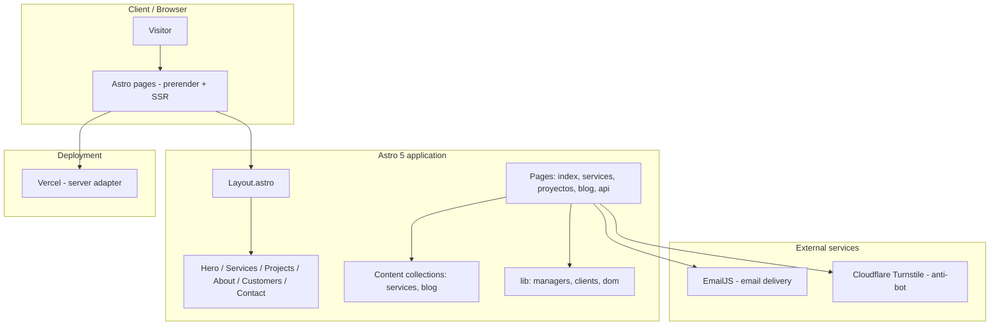

> **Language:** English | [Español](README_ES.md)

<p align="center">
  
</p>

<h1 align="center">SV Tech Official Website</h1>

<p align="center">
  <b>Corporate website of SV Tech SpA — IT support and custom web development for individuals, SMEs and businesses.</b>
</p>

<p align="center">
  <a href="https://astro.build/"></a>
  <a href="https://www.typescriptlang.org/"></a>
  <a href="https://tailwindcss.com/"></a>
  <a href="https://vercel.com/"></a>
  <a href="https://bun.sh/"></a>
  <a href="https://github.com/svtech-code/svtech-web-oficial/actions/workflows/ci.yml"></a>
  <a href="README_ES.md"></a>
</p>

<p align="center">
  <a href="#-overview">Overview</a> •
  <a href="#-features">Features</a> •
  <a href="#-architecture">Architecture</a> •
  <a href="#-project-structure">Project structure</a> •
  <a href="#-tech-stack">Tech stack</a> •
  <a href="#-getting-started">Getting started</a> •
  <a href="#-environment-variables">Environment variables</a> •
  <a href="#-commands">Commands</a> •
  <a href="#-deployment">Deployment</a> •
  <a href="#-seo-and-performance">SEO and performance</a> •
  <a href="#-secret-hygiene">Secret hygiene</a> •
  <a href="#-contributing">Contributing</a>
</p>

---

## 📖 Overview

Corporate website of **SV Tech** (legal name SV Tech SpA), a technology and IT-consulting company based in Linares, Maule Region (Chile), with on-site support in the area and remote support across the whole country.

The site is aimed at **clients** (individuals, SMEs and small/medium businesses) rather than a technical audience. Its goals are to:

1. Present the service catalogue (6 services, each with a detail page).
2. Demonstrate capability through real projects and clients.
3. Convert visitors into leads through a validated contact form.

## ✨ Features

| Category             | Description                                                                                                                     |
| :------------------- | :------------------------------------------------------------------------------------------------------------------------------ |
| 🚀 **Performance**   | Astro with prerendered static routes, responsive image `srcset`, manual code splitting (EmailJS and icons) and font preloading. |
| 📱 **Responsive**    | Adaptive layout with TailwindCSS 4 and custom CSS tokens (`--color-primary/secondary/tertiary`).                                |
| ♿ **Accessibility** | Semantic HTML, ARIA labels, skip links and keyboard navigation, with `prefers-reduced-motion` support.                          |
| 🔒 **Security**      | Contact form protected by Cloudflare Turnstile with server-side verification in `api/verify-turnstile.ts`.                      |
| 📧 **Form**          | EmailJS with real-time validation, loading/success/error states and input sanitization.                                         |
| 🧩 **Content**       | Astro content collections (services and blog) editable in Markdown with a typed schema.                                         |
| 🔎 **SEO**           | JSON-LD (`ProfessionalService`, `Service`, `CreativeWork`, breadcrumbs), automatic sitemap and Open Graph.                      |
| 🏗️ **Architecture**  | Manager pattern for complex logic, separation of concerns and TypeScript in strict mode.                                        |

## 🛠️ Architecture



## 🚀 Project Structure

```text
/
├── public/
│   ├── fonts/               # Web fonts (preload, WOFF2)
│   ├── images/              # Optimized images (WebP with srcset)
│   │   ├── blog/            # Article covers (cover + 540/800)
│   │   ├── customers/       # Client logos
│   │   ├── projects/        # Project imagery
│   │   └── services/        # Service imagery
│   ├── favicon.svg
│   ├── og.png
│   ├── robots.txt
│   └── llms.txt
├── src/
│   ├── assets/svg/          # SVG icons (social, UI, brand)
│   ├── components/
│   │   ├── cards/           # ServiceCard, ProjectCard, BlogCard, CustomerCard…
│   │   ├── common/          # Header, Footer, MetaTag, StructuredData, Analytics…
│   │   ├── forms/           # ContactForm, FormInput, FormTextarea…
│   │   ├── modals/          # Modal, ProjectModal and their states
│   │   └── ui/              # Icon, ButtonLink, CtaBanner, DetailHeader, RelatedList…
│   ├── consts/              # Static data and config (services, projects, customers, icons…)
│   ├── content/             # Astro collections (services/*.md, blog/*.md)
│   ├── layouts/             # Layout.astro (head, meta, structured data)
│   ├── lib/
│   │   ├── clients/         # emailjs-client, turnstile-manager
│   │   ├── dom/             # lazy-observer, dom-utils
│   │   ├── managers/        # Manager pattern (contact-form, project-modal, carousel…)
│   │   └── images.ts        # Responsive srcset helper
│   ├── pages/               # Routes (index, services/[slug], proyectos/[slug], blog, api)
│   ├── sections/            # Homepage sections
│   ├── styles/              # global.css and tokens
│   └── types/               # TypeScript definitions
├── .github/workflows/ci.yml # CI (lint + build + governance formatting)
├── astro.config.mjs
├── vercel.json
├── tsconfig.json
└── package.json
```

## 🛠️ Tech Stack

| Layer            | Technology                                                             |
| :--------------- | :--------------------------------------------------------------------- |
| **Framework**    | [Astro 5](https://astro.build/) (server mode with prerender)           |
| **Language**     | [TypeScript](https://www.typescriptlang.org/) in strict mode           |
| **Styling**      | [TailwindCSS 4](https://tailwindcss.com/) with CSS tokens              |
| **Runtime/PM**   | [Bun](https://bun.sh/)                                                 |
| **Deploy**       | [Vercel](https://vercel.com/) (`@astrojs/vercel`)                      |
| **Email**        | [EmailJS](https://www.emailjs.com/) (lazy-loaded)                      |
| **Anti-bot**     | [Cloudflare Turnstile](https://www.cloudflare.com/products/turnstile/) |
| **Integrations** | `@astrojs/sitemap`, `@astrojs/partytown`, `@vercel/speed-insights`     |
| **Quality**      | ESLint + Prettier                                                      |

## 🧞 Getting Started

Requirements: [Bun](https://bun.sh/).

```sh
# 1. Clone the repository
git clone https://github.com/svtech-code/svtech-web-oficial.git
cd svtech-web-oficial

# 2. Install dependencies
bun install

# 3. Set up environment variables
cp .env.example .env
#    Edit .env with your values (see "Environment variables")

# 4. Start the dev server
bun run dev
```

## 🔐 Environment Variables

The project reads configuration from `.env`. Use `.env.example` as a template; **never** commit `.env` (it is in `.gitignore`).

```env
# EmailJS (client)
PUBLIC_EMAILJS_PUBLIC_KEY=your_public_key
PUBLIC_EMAILJS_SERVICE_ID=your_service_id
PUBLIC_EMAILJS_TEMPLATE_ID=your_template_id
PUBLIC_EMAILJS_TO_NAME=your_to_name

# Cloudflare Turnstile
PUBLIC_TURNSTILE_SITE_KEY=your_site_key
TURNSTILE_SECRET_KEY=your_secret_key   # server-only: used in api/verify-turnstile.ts
```

> ⚠️ Only variables with the `PUBLIC_` prefix are exposed to the browser. `TURNSTILE_SECRET_KEY` stays on the server and must never reach the client.

## 🧞 Commands

| Command                | Action                                   |
| :--------------------- | :--------------------------------------- |
| `bun install`          | Install dependencies                     |
| `bun run dev`          | Start the dev server at `localhost:4321` |
| `bun run build`        | Build the site for production            |
| `bun run preview`      | Preview the production build locally     |
| `bun run lint`         | Run ESLint                               |
| `bun run lint:fix`     | Auto-fix ESLint issues                   |
| `bun run format`       | Format code with Prettier                |
| `bun run format:check` | Check formatting with Prettier           |

## 📦 Deployment

The project is configured for [Vercel](https://vercel.com/) with the `@astrojs/vercel` adapter (`output: 'server'`). Static routes (home, services, projects and blog posts) are prerendered; `api/verify-turnstile.ts` runs as a serverless function.

Deployment happens from the GitHub repository (`main`). `vercel.json` defines cache headers for `favicon.svg`, `og.png`, `robots.txt` and fonts.

## 🔎 SEO and Performance

- **JSON-LD structured data** for `ProfessionalService`, `Service`, `CreativeWork` and breadcrumbs.
- **Automatic sitemap** with per-section priorities and change frequencies.
- **Canonical / Open Graph / Twitter Cards** pointing to the apex host `https://svtech.cl`.
- **Responsive `srcset`** on content images (`-540.webp`, `-800.webp`, original `1000w`).
- **Manual code splitting** for EmailJS and icons; font preloading with `font-display: swap`.

## 🔐 Secret Hygiene

This repository must not contain secrets. Golden rules:

- **`.env` is in `.gitignore`** and is never committed. Only `.env.example` (names + placeholders) is versioned.
- **`TURNSTILE_SECRET_KEY` is server-only** and must never appear in client code or in `PUBLIC_`-prefixed variables.
- Before pushing, check that you have not included keys, tokens or passwords; if one slips through, revoke the credential immediately and scrub it from history.
- EmailJS keys are public by design (they ship to the browser), but should not be copied into the documentation.

## 🤝 Contributing

See the [Spanish contribution guide](CONTRIBUTING_ES.md) or its [English version](CONTRIBUTING.md) for the pull-request flow, checks and commit conventions (Conventional Commits in English).

## 📞 Contact

**SV Tech SpA** — IT support and custom web development.

- 🌐 Website: [svtech.cl](https://svtech.cl)
- 📧 Email: <contacto@svtech.cl>
- 📱 WhatsApp: [+56 9 8793 3282](https://wa.me/56987933282)
- 📍 Linares, Maule Region, Chile.
