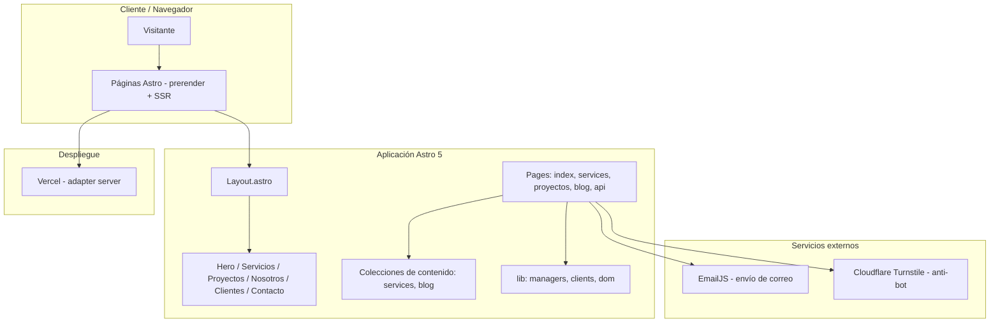

> **Idioma:** Español | [English](README.md)

<p align="center">
  
</p>

<h1 align="center">SV Tech Web Oficial</h1>

<p align="center">
  <b>Sitio corporativo de SV Tech SpA — soporte informático y desarrollo web a medida para particulares, pymes y empresas.</b>
</p>

<p align="center">
  <a href="https://astro.build/"></a>
  <a href="https://www.typescriptlang.org/"></a>
  <a href="https://tailwindcss.com/"></a>
  <a href="https://vercel.com/"></a>
  <a href="https://bun.sh/"></a>
  <a href="https://github.com/svtech-code/svtech-web-oficial/actions/workflows/ci.yml"></a>
  <a href="README.md"></a>
</p>

<p align="center">
  <a href="#-resumen">Resumen</a> •
  <a href="#-caracteristicas">Características</a> •
  <a href="#-arquitectura">Arquitectura</a> •
  <a href="#-estructura-del-proyecto">Estructura</a> •
  <a href="#-stack-tecnologico">Stack</a> •
  <a href="#-primeros-pasos">Primeros pasos</a> •
  <a href="#-variables-de-entorno">Variables de entorno</a> •
  <a href="#-comandos">Comandos</a> •
  <a href="#-despliegue">Despliegue</a> •
  <a href="#-seo-y-rendimiento">SEO y rendimiento</a> •
  <a href="#-higiene-de-credenciales">Higiene de credenciales</a> •
  <a href="#-contribuir">Contribuir</a>
</p>

---

## 📖 Resumen

Sitio web corporativo de **SV Tech** (razón social SV Tech SpA), empresa de tecnología y consultoría TI con base en Linares, Región del Maule, con atención presencial en la zona y soporte remoto en todo Chile.

La web está orientada a **clientes** (particulares, pymes y pequeñas/medianas empresas), no a un público técnico. Su objetivo es:

1. Presentar el catálogo de servicios (6 servicios con página de detalle).
2. Demostrar capacidad con proyectos y clientes reales.
3. Convertir visitantes en leads mediante un formulario de contacto validado.

## ✨ Características

| Categoría            | Descripción                                                                                                                              |
| :------------------- | :--------------------------------------------------------------------------------------------------------------------------------------- |
| 🚀 **Rendimiento**   | Astro con prerender de rutas estáticas, `srcset` responsivo en imágenes, code splitting manual (EmailJS e iconos) y precarga de fuentes. |
| 📱 **Responsive**    | Diseño adaptativo con TailwindCSS 4 y tokens CSS personalizados (`--color-primary/secondary/tertiary`).                                  |
| ♿ **Accesibilidad** | HTML semántico, labels ARIA, skip links y navegación por teclado, con soporte de `prefers-reduced-motion`.                               |
| 🔒 **Seguridad**     | Formulario protegido con Cloudflare Turnstile y verificación server-side en `api/verify-turnstile.ts`.                                   |
| 📧 **Formulario**    | EmailJS con validación en tiempo real, estados de carga/éxito/error y sanitización de inputs.                                            |
| 🧩 **Contenido**     | Colecciones de contenido Astro (servicios y blog) editables en Markdown con esquema tipado.                                              |
| 🔎 **SEO**           | JSON-LD (`ProfessionalService`, `Service`, `CreativeWork`, breadcrumbs), sitemap automático y Open Graph.                                |
| 🏗️ **Arquitectura**  | Patrón Manager para lógica compleja, separación de responsabilidades y TypeScript en modo strict.                                        |

## 🛠️ Arquitectura



## 🚀 Estructura del Proyecto

```text
/
├── public/
│   ├── fonts/               # Fuentes web (preload, WOFF2)
│   ├── images/              # Imágenes optimizadas (WebP con srcset)
│   │   ├── blog/            # Portadas de artículos (cover + 540/800)
│   │   ├── customers/       # Logos de clientes
│   │   ├── projects/        # Imágenes de proyectos
│   │   └── services/        # Imágenes de servicios
│   ├── favicon.svg
│   ├── og.png
│   ├── robots.txt
│   └── llms.txt
├── src/
│   ├── assets/svg/          # Iconos SVG (sociales, UI, marca)
│   ├── components/
│   │   ├── cards/           # ServiceCard, ProjectCard, BlogCard, CustomerCard…
│   │   ├── common/          # Header, Footer, MetaTag, StructuredData, Analytics…
│   │   ├── forms/           # ContactForm, FormInput, FormTextarea…
│   │   ├── modals/          # Modal, ProjectModal y sus estados
│   │   └── ui/              # Icon, ButtonLink, CtaBanner, DetailHeader, RelatedList…
│   ├── consts/              # Datos estáticos y configuración (services, projects, customers, icons…)
│   ├── content/             # Colecciones Astro (services/*.md, blog/*.md)
│   ├── layouts/             # Layout.astro (head, meta, structured data)
│   ├── lib/
│   │   ├── clients/         # emailjs-client, turnstile-manager
│   │   ├── dom/             # lazy-observer, dom-utils
│   │   ├── managers/        # Patrón Manager (contact-form, project-modal, carousel…)
│   │   └── images.ts        # Helper de srcset responsivo
│   ├── pages/               # Rutas (index, services/[slug], proyectos/[slug], blog, api)
│   ├── sections/            # Secciones de la portada
│   ├── styles/              # global.css y tokens
│   └── types/               # Definiciones TypeScript
├── .github/workflows/ci.yml # CI (lint + build + formato de gobernanza)
├── astro.config.mjs
├── vercel.json
├── tsconfig.json
└── package.json
```

## 🛠️ Stack Tecnológico

| Capa              | Tecnología                                                             |
| :---------------- | :--------------------------------------------------------------------- |
| **Framework**     | [Astro 5](https://astro.build/) (modo server con prerender)            |
| **Lenguaje**      | [TypeScript](https://www.typescriptlang.org/) en modo strict           |
| **Estilos**       | [TailwindCSS 4](https://tailwindcss.com/) con tokens CSS               |
| **Runtime / PM**  | [Bun](https://bun.sh/)                                                 |
| **Deploy**        | [Vercel](https://vercel.com/) (`@astrojs/vercel`)                      |
| **Email**         | [EmailJS](https://www.emailjs.com/) (carga lazy)                       |
| **Anti-bot**      | [Cloudflare Turnstile](https://www.cloudflare.com/products/turnstile/) |
| **Integraciones** | `@astrojs/sitemap`, `@astrojs/partytown`, `@vercel/speed-insights`     |
| **Calidad**       | ESLint + Prettier                                                      |

## 🧞 Primeros pasos

Requisitos: [Bun](https://bun.sh/).

```sh
# 1. Clona el repositorio
git clone https://github.com/svtech-code/svtech-web-oficial.git
cd svtech-web-oficial

# 2. Instala las dependencias
bun install

# 3. Configura las variables de entorno
cp .env.example .env
#    Edita .env con tus valores (ver sección "Variables de entorno")

# 4. Inicia el servidor de desarrollo
bun run dev
```

## 🔐 Variables de Entorno

El proyecto lee la configuración desde `.env`. Usa `.env.example` como plantilla; **nunca** subas `.env` al repositorio (está en `.gitignore`).

```env
# EmailJS (cliente)
PUBLIC_EMAILJS_PUBLIC_KEY=your_public_key
PUBLIC_EMAILJS_SERVICE_ID=your_service_id
PUBLIC_EMAILJS_TEMPLATE_ID=your_template_id
PUBLIC_EMAILJS_TO_NAME=your_to_name

# Cloudflare Turnstile
PUBLIC_TURNSTILE_SITE_KEY=your_site_key
TURNSTILE_SECRET_KEY=your_secret_key   # server-only: se usa en api/verify-turnstile.ts
```

> ⚠️ Solo las variables con prefijo `PUBLIC_` se exponen al navegador. `TURNSTILE_SECRET_KEY` se mantiene en el servidor y nunca debe quedar en el cliente.

## 🧞 Comandos

| Comando                | Acción                                     |
| :--------------------- | :----------------------------------------- |
| `bun install`          | Instala las dependencias                   |
| `bun run dev`          | Servidor de desarrollo en `localhost:4321` |
| `bun run build`        | Construye el sitio para producción         |
| `bun run preview`      | Previsualiza la build localmente           |
| `bun run lint`         | Ejecuta ESLint                             |
| `bun run lint:fix`     | Corrige problemas de ESLint                |
| `bun run format`       | Formatea el código con Prettier            |
| `bun run format:check` | Verifica el formato con Prettier           |

## 📦 Despliegue

El proyecto está configurado para [Vercel](https://vercel.com/) con el adapter `@astrojs/vercel` (`output: 'server'`). Las rutas estáticas (portada, servicios, proyectos y artículos de blog) se prerenderizan; la ruta `api/verify-turnstile.ts` corre como serverless function.

El despliegue se realiza desde el repositorio GitHub (`main`). `vercel.json` define las cabeceras de caché para `favicon.svg`, `og.png`, `robots.txt` y las fuentes.

## 🔎 SEO y Rendimiento

- **Structured data JSON-LD** para `ProfessionalService`, `Service`, `CreativeWork` y breadcrumbs.
- **Sitemap automático** con prioridades y frecuencias por sección.
- **Canonical / Open Graph / Twitter Cards** apuntando al host apex `https://svtech.cl`.
- **`srcset` responsivo** en imágenes de contenido (`-540.webp`, `-800.webp`, original `1000w`).
- **Code splitting** manual para EmailJS e iconos; precarga de fuentes con `font-display: swap`.

## 🔐 Higiene de Credenciales

Este repositorio no debe contener secretos. Reglas de oro:

- **`.env` está en `.gitignore`** y nunca se commitea. Solo se versiona `.env.example` con nombres y placeholders.
- **`TURNSTILE_SECRET_KEY` es server-only** y jamás debe aparecer en código de cliente ni en variables con prefijo `PUBLIC_`.
- Antes de subir un cambio, revisa que no hayas incluido claves, tokens ni contraseñas; si accidentalmente aparece alguno, revoca la credencial de inmediato y retírala del historial.
- Las claves de EmailJS son públicas por diseño (van al navegador), pero no deben copiarse a la documentación.

## 🤝 Contribuir

Consulta la [guía de contribución en español](CONTRIBUTING_ES.md) o su [versión en inglés](CONTRIBUTING.md) para conocer el flujo de pull requests, las verificaciones y las convenciones de commits (Conventional Commits en inglés).

## 📞 Contacto

**SV Tech SpA** — Soporte informático y desarrollo web a medida.

- 🌐 Sitio web: [svtech.cl](https://svtech.cl)
- 📧 Email: <contacto@svtech.cl>
- 📱 WhatsApp: [+56 9 8793 3282](https://wa.me/56987933282)
- 📍 Linares, Región del Maule, Chile.
